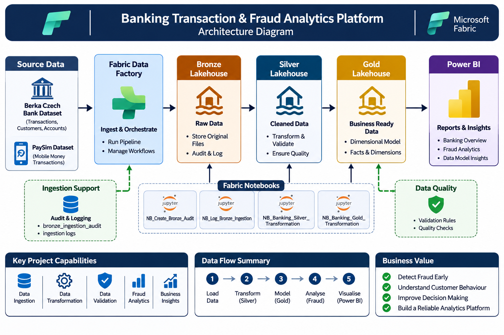

# Banking Transaction & Fraud Analytics Platform

## Project Overview

This project is an end-to-end banking transaction and fraud analytics platform built with Microsoft Fabric.

It processes two datasets, the Berka Czech Bank dataset and the PaySim synthetic mobile money dataset. The platform uses a Medallion Architecture to ingest, clean, validate, transform and analyse banking data.

## Architecture



## Technologies Used

- Microsoft Fabric
- Fabric Data Factory
- Fabric Lakehouse
- PySpark
- Python
- Delta Lake
- SQL and DAX
- Power BI
- Git and GitHub

## Data Sources

1. Berka Czech Bank dataset: Historical banking data covering customers, accounts, loans, cards and transactions.
2. PaySim dataset: Synthetic mobile money transactions containing fraud indicators.

## Data Engineering Workflow

### 1. Bronze Layer

- Ingests source files from GitHub.
- Uses a metadata-driven Fabric pipeline.
- Generates batch IDs.
- Stores original files in the Bronze Lakehouse.
- Records ingestion results in an audit table.

### 2. Silver Layer

- Cleans and standardises source data using PySpark.
- Converts data types and dates.
- Handles missing values.
- Performs validation and duplicate checks.
- Checks referential integrity.
- Removes sensitive client birth-number information.

### 3. Gold Layer

Builds seven analytical tables:

- dim_customer
- dim_account
- dim_district
- dim_date
- bridge_customer_account
- fact_bank_transactions
- fact_fraud_transactions

The Gold layer supports banking analysis and fraud analytics.

## Power BI Reports

The report contains three pages:

1. Banking Overview: Transaction volumes, transaction values and transaction types.
2. Fraud Analytics: Fraudulent transactions, fraud rates, transaction types and fraud trends.
3. Data Model & Insights: Customer, account, district and regional analysis.

## Data Volume

| Dataset | Records |
|---|---:|
| Berka datasets combined | 1,079,680 |
| PaySim | 6,362,620 |
| Total | 7,442,300 |

## Data Quality Results

- No duplicate primary keys in the Berka tables.
- No fully duplicated PaySim records.
- All eight Berka referential integrity checks passed.
- Required field validation passed.
- PaySim business rule validation passed.
- All Gold table validation checks passed.

## Project Results

- 7,442,300 records processed.
- 9 Silver tables created.
- 7 Gold analytical tables created.
- 8,213 fraudulent PaySim transactions identified.
- Approximately 0.129% fraud rate in the PaySim dataset.

## Repository Structure

```text
Banking-Transaction-Fraud-Analytics/
│
├── architecture/
├── documentation/
├── notebooks/
├── pipelines/
├── screenshots/
└── README.md
```

## Learning Outcomes

This project provided practical experience with:

- Data ingestion and orchestration.
- Metadata-driven pipelines.
- PySpark data transformation.
- Lakehouse architecture.
- Data quality and validation.
- Dimensional modelling.
- Fact and dimension tables.
- DAX measures.
- Power BI reporting.
- Data auditing and logging.
